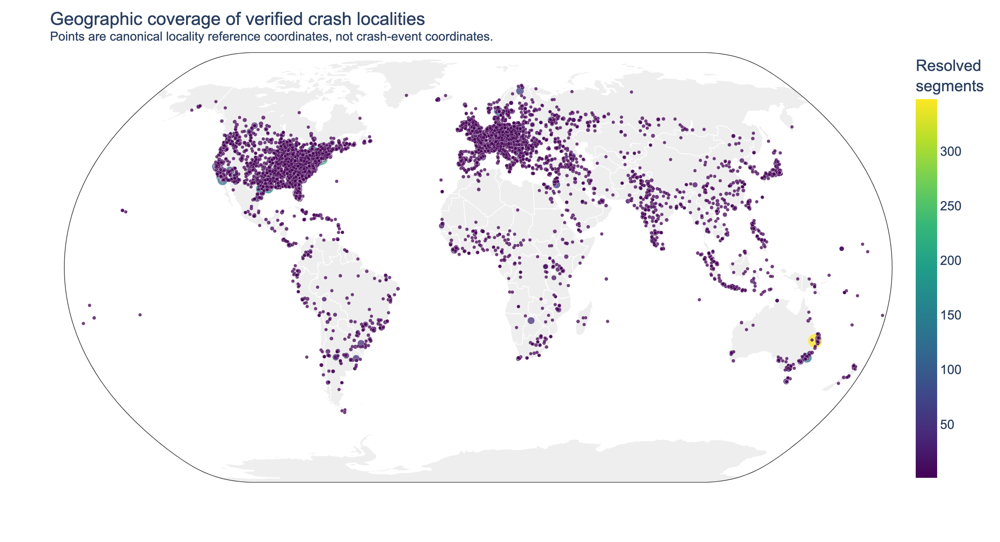
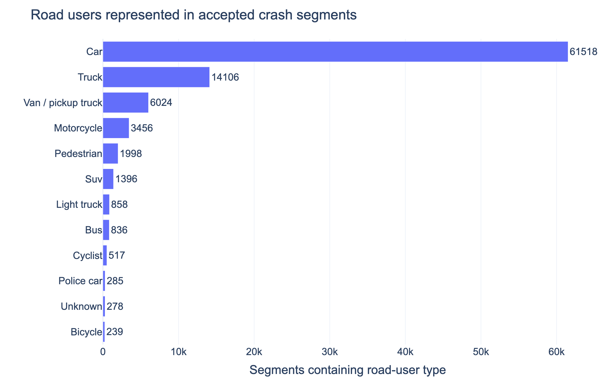
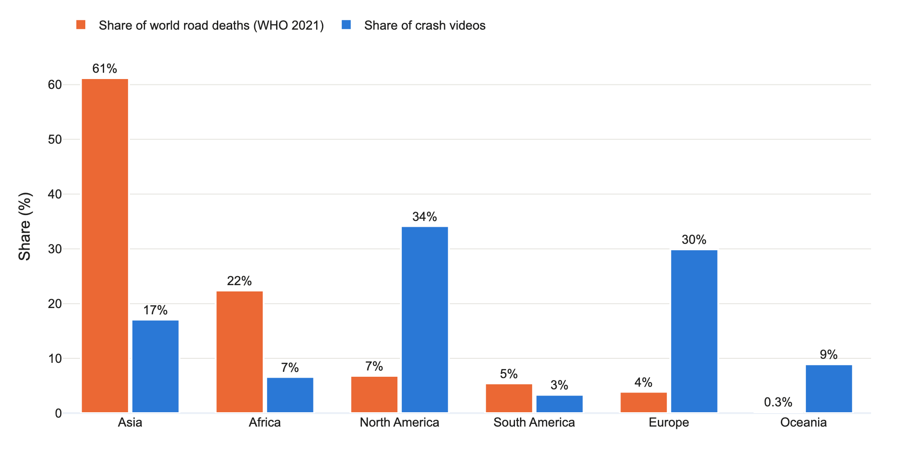
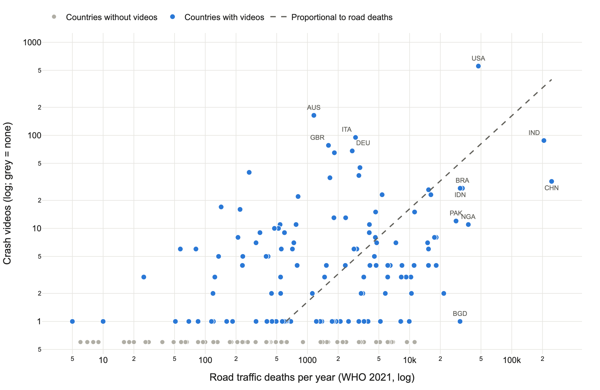

# Car Crash YouTube Dataset and Pipeline

[](https://www.python.org/downloads/release/python-31213/)
[](https://docs.astral.sh/uv/)
[](LICENSE)

A worldwide dataset of real road crashes and near collisions found in YouTube
dashcam and CCTV videos, and the open pipeline that builds it. The pipeline
discovers crash videos and compilations, rejects unsuitable uploads, splits
compilations into their complete source clips, keeps the clips that show a real
crash or near collision, describes each clip with a fixed vocabulary (including
the NHTSA MMUCC crash taxonomy), and places it in a locality only when the video
itself gives explicit evidence.

The repository contains the code and the published tables. It contains **no
videos and no frames from videos**: every row points to the public YouTube
video and the start and end time of the clip, and `download_videos.py` fetches
the videos for users who need them.



## At a glance

Snapshot of 2 November 2026; the numbers grow while the pipeline runs.

| | |
|---|---|
| Source videos | 2,591 |
| Crash and near-collision clips | 67,241 (61,374 collisions, 5,448 near collisions) |
| Total clip duration | about 271 hours |
| Upload years | 2007 to 2026 |
| Countries with at least one placed clip | 135 |
| Camera | 95% dashcam, 3% CCTV |
| Time of day | 82% day, 13% night, 4% dawn or dusk |

| Road users in the clips | Video coverage compared with road deaths |
|---|---|
|  |  |

The right-hand figure compares each continent's share of placed crash videos
with its share of the world's road traffic deaths (WHO, 2021). Europe, North
America and Oceania are strongly over-represented, while Asia and Africa, where
most road deaths happen, are under-represented. See
[Coverage](#coverage-and-representativeness) before drawing global conclusions.

## Contents

- [Dataset files](#dataset-files)
- [Getting the videos](#getting-the-videos)
- [How the pipeline works](#what-full-segment-means)
- [Running the pipeline](#running)
- [Analysis and figures](#analysis-and-figures)
- [Coverage and representativeness](#coverage-and-representativeness)
- [Label validation](#label-validation)
- [Tests](#tests)
- [Responsible use](#responsible-use)
- [Citation](#citation)
- [Acknowledgements](#acknowledgements)

## Dataset files

| File | Content |
|---|---|
| [`crash_segments.csv`](crash_segments.csv) | One row per accepted clip: video and segment IDs, YouTube URL, title, channel, upload date, start, impact and end time, event kind, MMUCC fields, camera view, road users, road environment, time of day, weather, road condition, visible outcomes, location evidence and the resolved place. |
| [`mapping.csv`](mapping.csv) | One row per locality: place names, ISO3 code, continent, coordinates, and the videos and clip times recorded there, with per-clip labels. Clips without a resolved place are collected in one row with an empty locality. |
| [`mapping_metadata.csv`](mapping_metadata.csv) | YouTube metadata for the videos in the mapping. |
| [`reference/country_baseline.csv`](reference/country_baseline.csv) | WHO 2021 road death estimates, World Bank population and registered vehicles per country, used for the coverage baseline. |

Main columns of `crash_segments.csv`:

| Column | Meaning |
|---|---|
| `segment_id`, `video_id`, `youtube_url` | Stable clip ID and its source video |
| `start_time`, `impact_time_in_video`, `end_time` | Clip boundaries and impact moment, in seconds from the start of the video |
| `event_kind` | `collision` or `near_collision` |
| `manner_of_collision`, `first_harmful_event`, `sequence_of_events` | MMUCC crash taxonomy fields, with their codes and `crash_taxonomy_version` |
| `camera_view` | `dashcam`, `cctv`, `action_camera`, `broadcast`, ... |
| `road_users`, `road_user_count` | Visible road user types and their number |
| `road_environment`, `time_of_day`, `weather`, `road_condition` | Scene description |
| `location_evidence`, `embedded_location_text`, `timestamp_labels` | The evidence used for the place |
| `locality`, `state`, `country`, `iso3`, `continent`, `lat`, `lon` | Resolved place; `lat`/`lon` are locality reference coordinates, not crash coordinates |

List fields use compact bracket notation, for example `[car,truck]`.

The model is told not to infer fault, injury, fatality, intent, identity or
legal responsibility, and the dataset contains no such fields.

## Getting the videos

`download_videos.py` reads `mapping.csv` and downloads every listed video that
is not yet present in the configured video folders:

```bash
cp default.config config      # set "videos" to your download folder(s)
python download_videos.py
```

Videos that have been removed or made private on YouTube are skipped.
Downloading must comply with YouTube's terms and the law where you work.

## What “full segment” means

A segment is the complete source clip between two verified compilation edits.
The segment starts when that source recording begins and ends at the next real
edit, rather than starting shortly before impact or stopping immediately after
it. If an upload contains no edit, the complete upload is one segment.

Segments and uploads may have any positive duration. The visual model still
receives a bounded number of uniformly distributed frames for predictable GPU
memory use, but the stored start and end times always describe the complete
source clip.

## Pipeline

1. YouTube discovery searches configured crash and dashcam queries.
2. A Qwen text model rejects games, simulations, films, crash tests,
   motorsport-only videos, and unrelated content before download.
3. `yt-dlp` downloads accepted videos into a temporary directory and moves only
   validated media into the processing directory.
4. FFmpeg proposes scene transitions using standard and adaptive detectors.
5. NVIDIA Cosmos 3 Nano verifies whether every proposal is a real compilation
   edit rather than camera motion, impact shake, occlusion, or exposure change.
6. Verified edit points define complete, variable length source clips.
7. Cosmos reviews a temporally uniform sample covering each complete clip.
8. Accepted crash segments are optionally geocoded only when metadata or
   readable embedded text explicitly supports a location.
9. State JSON and one-row-per-segment CSV output are updated atomically.

## Extracted information

Every accepted segment stores:

- YouTube video ID and stable segment ID
- full segment start, impact and end times
- crash confidence and short factual description
- crash type and camera viewpoint
- visible road user count and road user types
- road environment, time of day, weather and road condition
- visible outcomes
- author supplied timestamp and chapter labels
- embedded location text and its evidence source
- locality, state, country, ISO3, continent and coordinates when supported
- model version and raw model response in the JSON state

The prompt explicitly prohibits inferring fault, injury, fatality, intent,
identity or legal responsibility.

## Requirements

- Python 3.12.13
- `uv`
- FFmpeg and FFprobe
- `yt-dlp`
- a CUDA GPU suitable for Cosmos 3 Nano
- YouTube Data API credentials
- YouTube cookies when required by YouTube

Install the environment:

```bash
uv sync
```

Generate and commit a lock file for a frozen deployment when network access is
available:

```bash
uv lock
uv sync
```

Check the external commands:

```bash
ffmpeg -version
ffprobe -version
yt-dlp --version
ffmpeg -hide_banner -hwaccels
```

## Configuration

Create the active configuration and secret files:

```bash
cp default.config config
cp default.secret secret
```

Add one or more YouTube Data API keys to `secret`:

```json
{
  "YOUTUBE_API_KEYS": ["your-key"]
}
```

`config`, `secret`, `cookies.txt`, downloads, state and outputs are ignored by
Git.

To process a particular video before normal search discovery, put its eleven
character ID in `SEED_VIDEO_IDS`. For example:

```json
{
  "SEED_VIDEO_IDS": ["jJXT2zGlSc0"]
}
```

This value is only the ID, not the complete URL. Normal discovery continues in
the same cycle until `MAX_NEW_CANDIDATES` is reached.

Important settings include:

| Setting | Purpose |
|---|---|
| `DISCOVERY_QUERIES` | YouTube search terms |
| `SEED_VIDEO_IDS` | Explicit video IDs to add before search |
| `MAX_NEW_CANDIDATES` | Maximum new videos in a discovery batch |
| `MAX_VIDEOS_PER_RUN` | Maximum downloaded videos processed in one cycle |
| `CONTINUOUS_MODE` | Repeat discovery and processing cycles |
| `MIN_TEXT_CONFIDENCE` | Metadata acceptance threshold |
| `MIN_BOUNDARY_CONFIDENCE` | Verified compilation edit threshold |
| `MIN_CRASH_CONFIDENCE` | Accepted segment threshold |
| `MAX_REVIEW_CYCLES` | Maximum saved retry cycles before an invalid review is skipped |
| `SAMPLE_FRAME_COUNT` | Approximate frame budget across a complete segment |
| `SAMPLE_MAX_FPS` | Maximum sampling rate for short clips |
| `CUT_BACKEND` | `ffmpeg_cuda`, `ffmpeg_cpu`, or `auto` |
| `SCENE_THRESHOLD` | Standard FFmpeg scene sensitivity |
| `SCDET_THRESHOLD` | Adaptive scene detector sensitivity |
| `DELETE_VIDEO_AFTER_PROCESSING` | Delete a download after its final decision |
| `ENABLE_GEOCODING` | Resolve explicit locations with Nominatim |

There is deliberately no minimum video duration, maximum video duration,
minimum segment duration, or maximum segment duration setting.

Discovery stores one pagination cursor per query in `state.json`. A later cycle
continues from the next unvisited YouTube search page, while IDs already stored
under `videos` are never added to another processing batch. Keep `state.json`
when running continuously because it is the duplicate and pagination record.

## Running

Run once:

```bash
python main.py
```

or:

```bash
python -m car_crash_pipeline
```

Set `CONTINUOUS_MODE` to `true` for repeated batches. Stop with `Ctrl+C`; the
current state and CSV are saved and the next run resumes unfinished work.

## Outputs

By default, the pipeline writes below `data/`:

- `state.json`: the detailed record of every decision, model response, boundary
  review and accepted or rejected clip; it is also the resume and duplicate record
- `crash_segments.csv`: one row for every accepted clip
- `geocode_cache.json`: reusable Nominatim responses
- `videos/`: validated downloads, kept only when configured

The CSV is the analysis table; keep `state.json` for reproducibility.

## Running on a GPU cluster

`Dockerfile.spike1` builds a CUDA image for a Run:ai cluster. The image is
built with Docker build secrets for the configuration, API keys and cookies, so
push it only to a private registry. The workload runs one preemptible GPU job
and keeps `state.json`, the CSV and downloads on a persistent volume, so it can
be stopped and restarted at any time.

## Analysis and figures

```bash
python analysis.py            # tables in _output/crash/, figures in figures/crash/
```

`analysis.py` reads `state.json` and `mapping.csv` and writes the dataset
statistics, the location resolution outcomes, the taxonomy distributions and
the world maps shown in this README. HTML, PNG and PDF versions of every figure
are in [`figures/crash/`](figures/crash/).

## Coverage and representativeness

```bash
python coverage_baseline.py --walking-mapping ../walking-yt/mapping.csv
```

`coverage_baseline.py` compares each country's share of videos with its share
of the world's road traffic deaths (WHO 2021 estimates). It reports the
representation index (video share divided by death share), the share of road
deaths that happen in covered countries, and per-continent tables and figures
in `_output/coverage/`.

In the 2 November 2026 snapshot, 942 crash videos are placed in a country; the
other 1,649 have no location evidence and are left out of this comparison.
Countries with crash videos account for 92% of the world's road deaths, but the
five largest countries hold half of the placed videos, and Asia and Africa
(84% of road deaths) hold about a quarter of them.



## Label validation

[`validation/`](validation/) holds a two-reviewer kit for checking the
automatic labels against human judgement. It draws a stratified sample of 200
crash and 200 walking clips, splits it between two reviewers, serves a review
page that plays each clip from YouTube (or a short local snippet when YouTube
does not play it), and computes agreement and Cohen's kappa per label. See
[`validation/README.md`](validation/README.md).

## Tests

The fast tests do not load a model or access YouTube:

```bash
python -m unittest discover -s tests -v
```

They cover segment construction, cut proposal merging, crash decision
normalisation, location evidence, the crash taxonomy, the results analysis and
CSV row construction.

## Responsible use

Use the pipeline and the dataset only where collection and processing comply
with YouTube's terms, applicable copyright rules, research ethics approval,
privacy requirements and local law. Crash footage may contain distressing or
sensitive material. Do not redistribute the videos, do not publish frames that
identify people or number plates, and do not attempt to identify the people
involved. The labels are produced automatically; check them (see
[Label validation](#label-validation)) before relying on them.

## Citation

If you use the dataset or the code, please cite it as described in
[`CITATION.cff`](CITATION.cff) (GitHub's "Cite this repository" button).

## Acknowledgements

The videos were processed on the SPIKE-1 GPU cluster of Eindhoven University of
Technology. We thank the SPIKE team for the compute and support. The pipeline
uses NVIDIA Cosmos, Qwen, FFmpeg, yt-dlp, the YouTube Data API and
OpenStreetMap Nominatim; location data © OpenStreetMap contributors.

## License

The code is released under the [MIT License](LICENSE). The videos remain the
property of their uploaders and are not part of this repository.

## Contact

Md Shadab Alam (`md_shadab_alam@outlook.com`) and Pavlo Bazilinskyy
(`pavlo.bazilinskyy@gmail.com`). Issues and pull requests are welcome.
