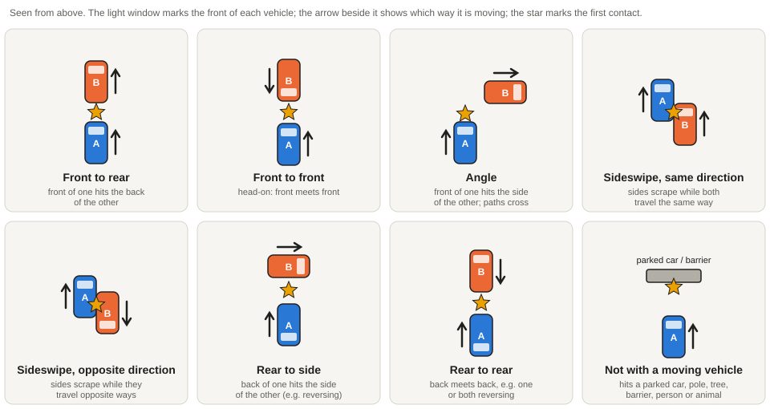

# Reviewer guide

Read this once before you start, and keep it open while you review. For each
question it explains what every answer means, how to decide between answers
that are easy to confuse, and links to example clips on YouTube. None of the
example clips is in the review sample.

General rules:

- **Judge only what you see in the clip.** Ignore the video title, channel and
  captions unless the question is about the location.
- **Use "Can't tell" when you cannot see enough.** A careful "Can't tell" is
  more useful than a guess.
- **When two answers both fit, use the tie-break rule** given under the
  question.
- **Use the note box** when something is unusual (several crashes in one clip,
  a compilation cut, an advert, a mistake in the clip boundaries).

Example links open YouTube at the moment that matters; each example lasts
5–20 seconds. Some examples show real crashes.

## Crash clips

### What does the clip show?

| Answer | Choose it when |
|---|---|
| A collision | Two road users, or a road user and an object, actually touch. Scraping a mirror counts. |
| A near-collision | A crash almost happens but there is no contact: hard braking, swerving, a very close pass. |
| No crash or near-collision | Normal driving, the aftermath only, or a clip that never shows the event. |
| Not real traffic footage | Video game, animation, film scene, studio presenter, channel intro or title cards. |

Tie-break: if you cannot see whether they touched, choose near-collision only
when both clearly keep moving undamaged; otherwise choose collision.

Examples:
[collision](https://www.youtube.com/watch?v=87wYUMyzDWA&t=0s) ·
[near-collision, car squeezes between a truck and the camera car](https://www.youtube.com/watch?v=Fh8xKnTKuOk&t=134s) ·
[near-collision at a roundabout, no contact](https://www.youtube.com/watch?v=HUH3siKwESw&t=239s) ·
[not real traffic, an animated channel intro](https://www.youtube.com/watch?v=2-_xZp1S-QU&t=0s)

### Is the whole event inside the clip?

**Yes** when the clip shows the lead-up, the contact (or near miss) and the
moment the vehicles come apart or stop. **Partly** when it starts after the
contact, or ends before it.

### Manner of collision

This is the first contact **between two moving vehicles**, as in the US crash
reporting standard (MMUCC). Look at which part of each vehicle touches first,
and which way each one is moving.

| Answer | Choose it when | Example |
|---|---|---|
| Front to rear | The front of one vehicle hits the back of another: a rear-end crash, including chain collisions in a queue. | [rear camera: a car slams into the back of the camera car](https://www.youtube.com/watch?v=LsOA73Vvx5g&t=356s) |
| Front to front | The fronts hit each other: a head-on crash, usually one car in the wrong lane. | [car crosses into the camera car's lane, head-on](https://www.youtube.com/watch?v=zYxLcpKZWNM&t=24s) |
| Angle | The front of one vehicle hits the **side** of the other; their paths cross. Most junction crashes: T-bone, a car pulling out, a car turning across traffic. | [car pulls out from the right, camera car hits its side](https://www.youtube.com/watch?v=87wYUMyzDWA&t=0s) · [car turns left across a truck (T-bone)](https://www.youtube.com/watch?v=78jC3XVBstw&t=1058s) · [roundabout: van fails to yield](https://www.youtube.com/watch?v=lEixX6SzMrw&t=660s) |
| Sideswipe, same direction | The **sides** touch while both move the same way, typically during a lane change or a merge. | [car sideswipes the camera car at an intersection](https://www.youtube.com/watch?v=EqnJ4wDI7oM&t=381s) |
| Sideswipe, opposite direction | The sides touch while the vehicles move in opposite directions, typically on a narrow road or when one drifts over the centre line. | [oncoming car sideswipes the car ahead of the camera car](https://www.youtube.com/watch?v=84u4ext_FZo&t=531s) |
| Rear to side | The **back** of one vehicle hits the side of another, usually while reversing. | see the diagram |
| Rear to rear | The backs of two vehicles hit each other; at least one is reversing. Rare. | see the diagram |
| Not with another moving vehicle | The vehicle hits something that is not a moving vehicle: a parked car, pole, tree, barrier, wall, pedestrian, cyclist or animal, or it rolls over on its own. | [car leaves the road and hits a tree (CCTV)](https://www.youtube.com/watch?v=E4n1mpyObSc&t=138s) · [car hits a parked car (CCTV)](https://www.youtube.com/watch?v=g6VfR2xUwO8&t=1203s) |
| Can't tell | The moment of first contact is not visible (out of frame, too dark, too far, cut). | |

How to decide:

- **Front to rear or angle?** Ask whether both were going the same way. Same
  way, one behind the other: front to rear. Paths crossing: angle.
- **Angle or sideswipe?** In an angle crash a **front** hits a side. In a
  sideswipe two **sides** slide along each other at a shallow angle.
- **Front to front or sideswipe, opposite direction?** If the fronts hit
  squarely, front to front. If they mainly scrape along the sides (mirrors,
  doors), sideswipe.
- **Parked vehicles do not count as moving vehicles.** Hitting a parked car is
  "Not with another moving vehicle", even when it looks like a rear-end.
- **Several impacts:** judge the **first** contact between two moving vehicles.

### Which best describes the crash?

This is a simpler description of the whole crash. It may differ from the
manner of collision: a car that rear-ends a queue causing a pile-up is
**Multi-vehicle pile-up** here and **Front to rear** above.

| Answer | Choose it when |
|---|---|
| Rear-end | One vehicle drives into the back of another. |
| Side impact | One vehicle hits the side of another (T-bone, angle, sideswipe). |
| Head-on | Front meets front. |
| Rollover | A vehicle turns onto its side or roof; choose this even if it hit something first. |
| Pedestrian struck / Cyclist struck | A person on foot or on a bicycle is hit. |
| Single vehicle | Only one vehicle is involved: it hits a barrier, pole, tree or leaves the road. |
| Multi-vehicle pile-up | Three or more vehicles are involved in a chain. |

### Camera

**Dashcam**: fixed inside or on a vehicle, front or rear. **CCTV / traffic
camera**: fixed on a building or pole, does not move
([example](https://www.youtube.com/watch?v=E4n1mpyObSc&t=138s)).
**Helmet / action camera**: worn by a cyclist or motorcyclist. **Handheld
phone**: filmed by a person holding the phone. **TV / news**: a broadcast with
studio graphics. **Drone**: filmed from the air.

### Time of day and weather

Judge the light and the sky, not street lights. **Dawn / dusk**: the sky is
visibly lighter on one side, or the light is low and orange. **Rain**: drops on
the windscreen, wipers running or wet reflections while it is falling. A wet
road after rain with a dry sky is **Clear / dry**. **Snow** includes snow on
the road even if it is not falling.

### Where does it happen?

| Answer | Choose it when |
|---|---|
| Motorway / highway | Several lanes per direction, a central barrier, no junctions with traffic lights, higher speed. |
| Urban street | Buildings close to the road, pavements, parked cars, lower speed. |
| Rural road | Open country, few buildings, often one lane per direction. |
| Junction / intersection | The crash happens **inside** a junction, or in its approach because of the junction (turning, crossing). |
| Roundabout | The crash happens on or at the entry of a roundabout. |
| Parking area | Car park, garage, petrol station forecourt or driveway. |

Tie-break: **the place of the crash wins over the type of road.** A crash at a
traffic-light junction in a city is **Junction**, not Urban street. A crash at
a roundabout is **Roundabout**, not Junction.

## Walking clips

### What does the clip mostly show?

**First-person walk** when the camera is carried by someone walking (it bobs
gently and moves at walking speed). Choose **Filmed from a vehicle** for car,
bus, boat or bicycle footage, **Drone / aerial** for footage from above,
**Static camera** when the camera does not move, and **Ads, intro, title
cards** for anything that is not footage of the place. Judge the majority of
the clip.

### Main environment

Pick the environment that fills **most of the clip** (roughly two thirds or
more). If no single environment does, pick **Mixed**.

| Answer | Choose it when | Example |
|---|---|---|
| Street | A road or alley lined with buildings, shops or houses. Shops **inside buildings** are still Street. | [alleys and side streets](https://www.youtube.com/watch?v=InOzQR0dhF8&t=1407s) · [shopping street with shopfronts](https://www.youtube.com/watch?v=Ub3DDqPwC6A&t=28786s) |
| Square / plaza | A wide open paved space surrounded by buildings, people standing or walking in all directions. | [St Mark's Square, Venice](https://www.youtube.com/watch?v=NAwI19WQDVc&t=3323s) |
| Market | Stalls, carts or goods laid out **in the walkway** dominate the view: vendors, produce, tarpaulins, crowds browsing. | [street stalls with fruit vendors](https://www.youtube.com/watch?v=VDgOqO2Wcg0&t=2131s) |
| Park / nature | Grass, trees or open country with a maintained path. | [path through a mountain valley meadow](https://www.youtube.com/watch?v=Qj0TbRiRjFE&t=2194s) |
| Trail | A narrow unpaved path through forest, hills or mountains; hiking rather than strolling. | [forest trail](https://www.youtube.com/watch?v=jpOz4F49i8A&t=9214s) |
| Waterfront | A promenade, quay or path **next to** a river, lake, harbour or the sea, walked on a hard surface. | [river promenade](https://www.youtube.com/watch?v=BEWAmNaD8G8&t=5209s) · [seafront promenade beside a beach](https://www.youtube.com/watch?v=mZbShbScrIU&t=515s) |
| Beach | Walking **on the sand** or at the water's edge. | [walking on the sand](https://www.youtube.com/watch?v=yLnuMEOdj24&t=300s) |
| Indoor | Inside a building: shopping mall, museum, covered arcade. | [shopping mall](https://www.youtube.com/watch?v=5LNojExy9jI&t=4002s) |
| Station / transport hub | Train, metro or bus station, airport: platforms, ticket gates, departure boards. | [ticket gates and train platforms](https://www.youtube.com/watch?v=0kmujeXT_4w&t=835s) |
| Mixed | The walk changes environment and none fills most of the clip. | [street, then a café terrace, then a shore path](https://www.youtube.com/watch?v=AJDuACCorvI&t=2202s) |

How to decide:

- **Street or market?** Count the stalls. Shopfronts in buildings along the
  road: Street. Stalls, carts or goods spread into the walkway for most of the
  clip: Market. A street with a few stalls is still Street.
- **Street or square?** A square is wide and open in all directions, often with
  a monument or fountain; a street is a corridor you walk along.
- **Park or trail?** A maintained or paved path in a park or meadow: Park /
  nature. A narrow dirt path in forest or hills: Trail.
- **Waterfront or beach?** On a paved promenade beside the water: Waterfront.
  On the sand: Beach.
- **Indoor or transport hub?** Inside a station or airport: Transport hub; any
  other building: Indoor. Covered shopping arcades are Indoor.

### Time of day

As for crash clips. Choose **Night** when the sky is dark, even in a brightly
lit street.

## Location (both datasets)

The page shows where the pipeline placed the clip. Answer **Yes, or nothing
contradicts it** when the signs, language, number plates, landmarks or driving
side fit that place, or when nothing in the clip says otherwise. Answer **No**
only when something you see clearly contradicts it (for example, the clip is
placed in Spain but the signs are in Thai, or the cars drive on the wrong side
for that country). Use the note box to say what contradicts it. Title and
channel name are allowed as evidence for this question only.
